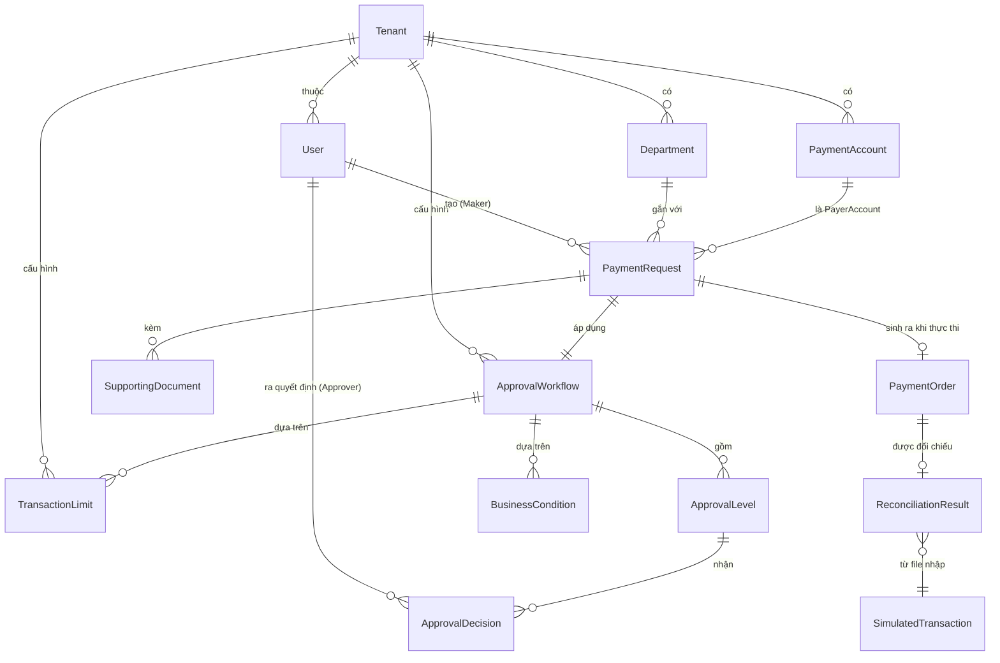

# Architecture — PayFlow Enterprise

> Tài liệu này mô tả **kiến trúc đề xuất cho MVP**, bám sát ràng buộc thực tế trong `docs/prd.md`: **1 backend developer chính** (Angular mức cơ bản), **deadline 8 tuần**, open-source only, chạy local bằng Docker Compose. Đây không phải kiến trúc "lý tưởng" cho nhóm phát triển lớn — mọi lựa chọn đều cân nhắc đội hình và thời gian.
>
> Mọi tên module/entity/bảng dùng đúng tên code trong `docs/domain-glossary.md`. Tên kỹ thuật nội bộ (không phải thuật ngữ nghiệp vụ) được đánh dấu **[KT]** (kỹ thuật nội bộ) và không được hiển thị cho người dùng.
>
> Nhiều thiết kế dưới đây **tạm thời** và phụ thuộc câu trả lời Open Questions (OQ-01 → OQ-15) trong `docs/prd.md`; chỗ nào chưa chốt được ghi rõ `[CẦN LÀM RỎ: OQ-xx]` và được tổng hợp ở mục 7.

---

## 1. Kiến trúc tổng quan

PayFlow Enterprise là một **Modular Monolith** (theo `ModularMonolith` — glossary 3.8): một ứng dụng ASP.NET Core duy nhất host trong **một process**, chia nội bộ theo các module nghiệp vụ tổ chức theo domain. Mọi module dùng chung một database PostgreSQL và một Unit of Work (`IUnitOfWork`) — không có service riêng, không có message broker ngoài, không có network call nội bộ. Đây là lựa chọn có chủ đích: với 1 developer và 8 tuần, modular monolith giữ chi phí vận hành và debug ở mức thấp nhất trong khi vẫn cho phép tách module sau này (NFR-03).

**Luồng dữ liệu chính** (xác nhận điều kiện nghiệm thu SM-01):

1. `Accountant` tạo `PaymentRequest` (trạng thái `Draft`) → Lưu cùng `SupportingDocument` (FR-07).
2. `Maker` gửi đề nghị → chuyển `Pending Approval`; hệ thống xác định `ApprovalWorkflow` áp dụng từ `TransactionLimit` và `BusinessCondition` (FR-08).
3. Mỗi `Approver` ở từng `ApprovalLevel` ra `ApprovalDecision` (`Approve`/`Reject`); cấp kế chỉ mở khi cấp trước Approve (FR-13); **Maker-Checker** chặn `Maker` tự phê duyệt ở server (FR-15).
4. Đề nghị đạt `Approved` → **cùng một transaction**, hệ thống tạo `PaymentOrder` (mang `IdempotencyKey`) và ghi một bản ghi `Outbox` [KT] (FR-18, FR-19).
5. Background worker đọc `Outbox` → gửi `PaymentOrder` qua `IBankGateway` (MVP dùng `MockBankGateway`) (FR-18).
6. Nhận `GatewayResult` → `PaymentOrder` chuyển `Completed` (kèm `TransactionId`) hoặc `Failed` (kèm `ErrorCode`) (FR-20); timeout → `Unknown`, không tự gửi lại (FR-21).
7. `Treasury` nhập file `SimulatedTransaction` → hệ thống đối chiếu với `PaymentOrder` → `ReconciliationResult` (`Matched`/`Discrepancy`) (FR-27, FR-28).
8. Mọi thao tác quan trọng đều ghi `AuditLog` bất biến, cho phép `Traceability` ngược từ `ReconciliationResult` về `PaymentRequest` (FR-25, FR-26, NFR-05).

**Diagram:**

```mermaid
flowchart TB
    subgraph Client
        UI[Angular — SPA cho P1–P6]
    end

    subgraph Host["PayFlow.HttpApi.Host — Modular Monolith (1 process)"]
        API[HTTP API layer — FR-29]
        subgraph Modules["Module nghiệp vụ"]
            ORG[PayFlow.Organization]
            PR[PayFlow.PaymentRequests]
            APPR[PayFlow.Approvals]
            EXEC[PayFlow.PaymentExecution]
            RECON[PayFlow.Reconciliation]
            AUD[PayFlow.Auditing]
        end
        ABPMOD[ABP modules: Identity / TenantManagement / PermissionManagement / SettingManagement / AuditLogging]
        BG[Background worker — dispatcher Outbox [KT]]
        GW[IBankGateway — abstraction FR-18/NFR-03]
        MOCK[MockBankGateway — FR-24]
    end

    subgraph Data
        PG[(PostgreSQL — shared schema, cột TenantId)]
        BLOB[(Blob storage local — SupportingDocument, OQ-08)]
    end

    UI -->|HTTPS / OIDC| API
    API --> Modules
    Modules --> ABPMOD
    PR -->|cùng UoW: tạo PaymentOrder + Outbox| PG
    BG -->|đọc Outbox [KT]| PG
    BG --> GW
    GW --> MOCK
    MOCK -->|GatewayResult| BG
    BG -->|ghi trạng thái Completed/Failed/Unknown| PG
    Modules --> PG
    Modules --> BLOB
    API --> AUD
```

**Điểm mấu chốt về tính nhất quán (NFR-04):** mọi bước chuyển trạng thái nghiệp vụ (`PaymentRequest`, `PaymentOrder`) và việc ghi `Outbox` diễn ra trong **một transaction của `IUnitOfWork`**. Worker xử lý `Outbox` là **at-least-once**, nhưng vì mỗi `PaymentOrder` mang `IdempotencyKey` duy nhất (FR-19) nên hiệu ứng thực thi là **exactly-once**: crash giữa chừng không mất lệnh, retry không tạo Giao dịch ngân hàng mới.

---

## 2. Tech Stack

Mỗi lựa chọn gắn với lý do cụ thể, không phải wishlist.

| Thành phần | Lựa chọn | Lý do (gắn FR/NFR) |
|---|---|---|
| Backend framework | ASP.NET Core trên ABP Framework (.NET 10) | **Ràng buộc kỹ thuật #1** của PRD. ABP cung cấp sẵn Unit of Work (`IUnitOfWork` — NFR-04), Multi-tenancy filter (`TenantIsolation` — NFR-02), audit (`AuditLog` — FR-25), permission management (FR-03) — cắt giảm lớn cho 1 dev/8 tuần. |
| Kiến trúc ứng dụng | Modular Monolith (ModularMonolith) | **NFR-03** yêu cầu thêm module không sửa module cũ, đồng thời PRD **loại microservices** (Scope ngoài phạm vi). 1 process = chi phí debug/vận hành thấp cho đội hình 1 người. |
| ORM | EF Core | **Ràng buộc #3**. Hỗ trợ `ConcurrencyStamp` (optimistic concurrency — NFR-04) và global query filter cho cô lập theo `Tenant` (NFR-02). |
| Database | PostgreSQL | **Ràng buộc #3 + NFR-04**: ACID transaction cho Unit of Work; hỗ trợ schema để sau này tách per-tenant (đường mở rộng NFR-03); open-source (hạn mức ngân sách). |
| Frontend | Angular (SPA) | **Ràng buộc #10**. ABP có template Angular + sẵn integration OIDC. Mức "cơ bản" theo team → giữ UI mỏng, gọi API. |
| Môi trường | Docker Compose | **NFR-06**: chạy local hoàn toàn, không phụ thuộc Internet/cloud trả phí; SM-06 (dựng lại máy sạch). |
| Background processing | ABP BackgroundJob + bảng `Outbox` [KT] trong cùng PostgreSQL | **FR-19/FR-22/NFR-04**: outbox ghi cùng transaction (không mất lệnh khi crash) + job framework có sẵn của ABP. **Không dùng message broker ngoài** (RabbitMQ/Kafka): NFR-06 yêu cầu không dịch vụ ngoài cho MVP; 1 dev không gánh thêm operational burden. Xem mục 7 về trade-off. |
| Authentication | OpenIddict (OIDC) + ASP.NET Identity của ABP | NFR-02: chuẩn OAuth2/OIDC thay vì tự làm token; Identity module của ABP cung cấp `User`/`Role`/đăng nhập. |
| Blob storage (SupportingDocument) | ABP BlobStoring với provider local filesystem | FR-07. Đổi sang S3/R2 sau chỉ cần đổi provider, không sửa code nghiệp vụ. `[CẦN LÀM RỎ: OQ-08 — dung lượng/định dạng]`. |
| Caching | In-memory cache của ABP (bộ nhớ process) | NFR-01 (P95 đọc ≤ 500ms). Đủ cho MVP 1 instance. **Không dùng Redis** ở MVP: thêm hạ tầng ngoài, chưa cần (1 process). Xem mục 7. |
| Logging | Serilog (kết hợp `AuditLog` của ABP cho nghiệp vụ) | Phân biệt: Serilog = log kỹ thuật cho nhà phát triển; `AuditLog` = nhật ký nghiệp vụ bất biến cho người dùng/kiểm toán (FR-25). Không dùng Serilog thay `AuditLog`. |
| Kiểm thử | xUnit + ABP TestBase (giải pháp đã có sẵn các project `*.Tests`) | FR-30: unit, integration (EF Core + PostgreSQL thật), API security test, concurrency test. |

---

## 3. Module/Component breakdown

Theo repo hiện có (layered solution: Domain / Domain.Shared / Application / Application.Contracts / EntityFrameworkCore / HttpApi / HttpApi.Host). Với 1 dev/8 tuần, mỗi module nghiệp vụ tổ chức theo **namespace folder** trong các project layered sẵn có (không tách project riêng cho từng module để giảm boilerplate), phụ thuộc giữa module chỉ qua **contract** ở tầng Application.Contracts. Trade-off và điều kiện tách project riêng sau này: xem mục 7.

### 3.1 Module ABP dùng lại (không tự viết)

| Module | Cung cấp | FR liên quan | Thuật ngữ glossary |
|---|---|---|---|
| ABP Identity | Đăng nhập, quản lý tài khoản | FR-01, FR-02 | `User`, `Member` |
| ABP Tenant Management | CRUD `Tenant`, resolve tenant hiện tại | FR-01 | `Tenant`, `MultiTenancy` |
| ABP Permission Management | Gán `Permission` theo `Role`, kiểm tra server-side | FR-03 | `Role`, `Permission`, `Authorization` |
| ABP Setting Management | Cấu hình theo Tenant | FR-06 (gán nơi lưu cấu hình) | `Tenant` |
| ABP Audit Logging | Ghi `AuditLog` tự động cho app service call | FR-25, FR-26 | `AuditLog`, `BusinessHistory` |

### 3.2 Module nghiệp vụ tự xây

| Module (namespace) | Trách nhiệm | Entity chính | FR | Thuật ngữ glossary |
|---|---|---|---|---|
| `PayFlow.Organization` | Tổ chức bên trong `Tenant`: phòng ban, tài khoản thanh toán | `Department`, `PaymentAccount` | FR-04, FR-05 | `Department`, `PaymentAccount` |
| `PayFlow.PaymentRequests` | Vòng đời `PaymentRequest`, enforced `StateTransitionMatrix`, CRUD theo trạng thái hợp lệ | `PaymentRequest`, `SupportingDocument` | FR-07, FR-09, FR-10, FR-11, FR-12 | `PaymentRequest`, `PaymentRequestStatus`, `StateTransitionMatrix`, `SupportingDocument`, `Maker` |
| `PayFlow.Approvals` | Xác định & thực thi `ApprovalWorkflow`; enforcing **Maker-Checker**; lưu `ApprovalDecision` bất biến | `ApprovalWorkflow`, `ApprovalLevel`, `ApprovalDecision`, `TransactionLimit`, `BusinessCondition` | FR-06, FR-08, FR-13, FR-14, FR-15, FR-16, FR-17 | `ApprovalWorkflow`, `ApprovalLevel`, `ApprovalDecision`, `ApprovalHistory`, `TransactionLimit`, `BusinessCondition`, `Approver`, `Maker-Checker` |
| `PayFlow.PaymentExecution` | Thực thi: tạo `PaymentOrder` + `Outbox`, dispatch qua `IBankGateway`, áp dụng `IdempotencyKey`, xử lý `GatewayResult`/`Timeout`, cho phép Tra soát | `PaymentOrder` | FR-18, FR-19, FR-20, FR-21, FR-22, FR-23, FR-24 | `PaymentExecution`, `PaymentOrder`, `IBankGateway`, `MockBankGateway`, `IdempotencyKey`, `GatewayResult`, `TransactionId`, `ErrorCode`, `TransactionInvestigation`, `Unknown` |
| `PayFlow.Reconciliation` | Import `SimulatedTransaction`, đối chiếu hàng loạt với `PaymentOrder`, ghi `ReconciliationResult` | `SimulatedTransaction`, `ReconciliationResult` | FR-27, FR-28 | `Reconciliation`, `ReconciliationResult`, `SimulatedTransaction`, `Matched`, `Discrepancy` |
| `PayFlow.Auditing` | Xem `BusinessHistory` (timeline) + `Traceability` cho một đối tượng | (view, không entity mới) | FR-25, FR-26 | `BusinessHistory`, `Traceability` |
| `PayFlow.BankGateways` | Triển khai `IBankGateway`: `MockBankGateway` + bộ điều khiển kịch bản lỗi | — | FR-18, FR-24 | `IBankGateway`, `MockBankGateway` |

> **Ghi chú tên module `PayFlow.Organization`:** đây là **tên kỹ thuật nội bộ** cho module quản lý tổ chức bên trong Doanh nghiệp (`Department`, `PaymentAccount`). Nó **không** vi phạm cấm ngữ của glossary (cấm dùng “organization” làm đồng nghĩa của `Tenant`) — module này không đại diện cho `Tenant` (tenant do ABP Tenant Management quản lý). Nếu khi review thấy gây nhầm, đổi tên module phải ghi vào `docs/decisions.md` và cập nhật cả tên trong glossary nếu trở thành tên được dùng rộng rãi.

### 3.3 Quy tắc phụ thuộc giữa module

- `PayFlow.Approvals` phụ thuộc `PayFlow.Organization` (đọc `Department` để gán approver) và `PayFlow.PaymentRequests` (qua contract, không tham chiếu trực tiếp entity nội bộ).
- `PayFlow.PaymentExecution` phụ thuộc contract của `PayFlow.PaymentRequests` (đọc `PaymentRequest` đã `Approved`) — không phụ thuộc ngược.
- `PayFlow.Reconciliation` phụ thuộc contract của `PayFlow.PaymentExecution` (đọc `PaymentOrder`).
- Module **không** được tham chiếu entity nội bộ của module khác — chỉ qua interface/DTO ở Application.Contracts. Enforce bằng convention + test kiến trúc (FR-30).

---

## 4. Bảo mật

Map với **NFR-02** của `docs/prd.md`.

**Authentication (xác thực):** OpenIddict chuẩn OIDC; Angular đăng nhập nhận access token; mọi API nghiệp vụ yêu cầu token hợp lệ. `User` quản lý qua ABP Identity.

**Authorization (phân quyền) — nhiều lớp theo ràng buộc #9:**

1. **Function authorization** (FR-03, NFR-02): mỗi application service method gắn permission requirement qua ABP; kiểm tra ở **server-side**, không phụ thuộc UI có ẩn nút. 100% API nghiệp vụ được phủ.
2. **Tenant isolation** (FR-01, NFR-02, SM-02): EF Core global query filter tự gắn `TenantId` từ tenant resolve của ABP; mọi query mặc định chỉ trả về dữ liệu `Tenant` hiện tại. Platform Admin thao tác cấp hệ thống phải đi qua service riêng, không dùng chung query.
3. **Resource authorization** (FR-11): ngoài việc đúng tenant, đọc chi tiết `PaymentRequest` còn kiểm tra phạm vi theo `Role` + `Department` của người gọi (VD `DepartmentManager` chỉ thấy đề nghị trong phòng ban phụ trách).
4. **Business rule check** (FR-15, NFR-02 — Maker-Checker): chặn `Maker` tự phê duyệt thực thi ở **domain service** (không phải ở UI hay API filter), đảm bảo gọi API trực tiếp cũng bị chặn. Test tự động gọi API chứng minh.

**Xử lý secret:** secret (chuỗi kết nối DB, key OIDC) đặt qua biến môi trường / user-secrets local, **không commit vào repo** (NFR-02). Docker Compose local đọc từ `.env` (không commit) hoặc secret injection.

**Threat mặc định phải chống (và cách chống):**

| Threat | Cách chống | FR/NFR |
|---|---|---|
| **IDOR** ( đoán ID để đọc/chỉnh tài nguyên khác ) | Mọi truy cập theo id đều đi qua query filter `TenantId` + resource authorization; không có endpoint trả data theo id thuần | FR-01, FR-11, NFR-02 |
| **Cross-tenant data leak** | Global query filter + API security test khẳng định 0 leak (SM-02) | NFR-02 |
| **Tự phê duyệt (vi phạm Maker-Checker)** | Block ở domain service, test gọi API trực tiếp | FR-15, NFR-02 |
| **Gửi trùng lệnh / double-pay** | `IdempotencyKey` unique trên `PaymentOrder` + outbox ghi trong transaction; test concurrency | FR-19, NFR-04 |
| **SQL injection** | EF Core parameterized query; không dùng raw SQL ghép chuỗi | NFR-02 |
| **Chỉnh sửa AuditLog** | `AuditLog` bất biến: không expose API update/delete; DB permission chỉ cho insert | FR-25, NFR-02 |
| **XSS / injection phía client** | Angular sanitize input; CSP headers | NFR-02 |
| **Rate limiting / brute force** | `[CẦN LÀM RỎ: OQ-12 — rate limiting/MFA có bắt buộc cho MVP không]` — nếu bắt buộc, dùng middleware ASP.NET Core rate limiter | NFR-02 |

---

## 5. Performance

**Target (lấy từ NFR-01 — `[CẦN LÀM RỎ: OQ-10 — chờ xác nhận số liệu]`):**

- API đọc/danh sách: **P95 ≤ 500 ms** (phân trang + phân quyền + lọc tenant).
- API thao tác nghiệp vụ (tạo đề nghị, quyết định phê duyệt, gửi lệnh): **P95 ≤ 1.000 ms** — gửi gateway **không chặn** request chính (đi qua outbox + background worker).
- Chịu tải tham chiếu: **50 người dùng đồng thời**, **≥ 10.000 `PaymentRequest`** cho tenant lớn nhất mà không giảm dưới ngưỡng trên.

**Chiến lược đạt được:**

| Chiến lược | Giải quyết | Chi tiết |
|---|---|---|
| **Gửi ngân hàng bất đồng bộ qua Outbox** | P95 thao tác ≤ 1s | Request chỉ ghi `PaymentOrder` + `Outbox` (1 transaction nội bộ, vài ms); việc gọi `IBankGateway` chạy ở background worker tách khỏi luồng request (FR-18, NFR-01). |
| **Index DB đầy đủ** | P95 đọc, throughput | Index trên `(TenantId, Status)`, `(TenantId, MakerId)`, `(TenantId, DepartmentId)` cho `PaymentRequest`; unique index `(IdempotencyKey)` cho `PaymentOrder`; index `(TenantId, PaymentOrderId)` cho `ReconciliationResult`. |
| **Tránh N+1** | throughput | Dùng `Include` có chủ đích / projection DTO; list view không load entity full. |
| **In-memory cache cho config tĩnh** | P95 | `ApprovalWorkflow` + `TransactionLimit` + `BusinessCondition` của Tenant ít thay đổi → cache theo tenant, invalidate khi TenantAdmin cấu hình lại. |
| **Phân trang bắt buộc** | throughput, memory | Mọi list endpoint phân trang server-side; không load toàn bộ danh sách. |
| **Đọc không theo dõi (AsNoTracking)** | P95 đọc | Các query chỉ-đọc (list, chi tiết, BusinessHistory) dùng `AsNoTracking`. |
| **Connection pooling + async I/O** | concurrent users | Toàn bộ đường request async `await`; EF Core connection pooling của PostgreSQL. |

**Nếu vượt ngưỡng trên khi scale:** xem mục 7 (caching đa instance, read replica, tách schema).

---

## 6. Data model tổng quan

Entity chính và quan hệ (không liệt kê từng field). Tên entity khớp glossary; tên **[KT]** là kỹ thuật nội bộ, **không phải thuật ngữ nghiệp vụ**.



**Diễn giải các quan hệ chính:**

- `PaymentRequest` là trung tâm: có `Maker` (người tạo), gắn `Department`, chọn `PaymentAccount` làm `PayerAccount`, đi kèm nhiều `SupportingDocument`.
- Khi `PaymentRequest` được gửi đi, `ApprovalWorkflow` áp dụng được xác định (từ `TransactionLimit` + `BusinessCondition`), gồm nhiều `ApprovalLevel`, mỗi cấp nhận các `ApprovalDecision`.
- Khi `PaymentRequest` đạt `Approved` và được thực thi → sinh ra tối đa **một** `PaymentOrder` (mang `IdempotencyKey` duy nhất) — `PaymentOrder` mang `PaymentRequestStatus` chung (xem `[CẦN LÀM RỎ: OQ-01]`).
- `ReconciliationResult` liên kết `PaymentOrder` với `SimulatedTransaction` đã import, kết quả là `Matched` hoặc `Discrepancy`.

**Bảng kỹ thuật nội bộ [KT] (không phải thuật ngữ nghiệp vụ, không hiển thị cho người dùng):**

- Bảng `Outbox` [KT]: lưu các lệnh chờ dispatch đi `IBankGateway`, ghi cùng transaction với `PaymentOrder`. Cột: Id, TenantId, PaymentOrderId, Trạng thái dispatch, Số lần thử, Thời điểm thử kế tiếp.
- Bảng `AuditLog`: dùng chung module Audit Logging của ABP (bất biến, FR-25).

**Trạng thái `PaymentRequest`/`PaymentOrder`:** dùng chung một enum `PaymentRequestStatus` (8 giá trị theo glossary 3.3). `[CẦN LÀM RỎ: OQ-01 — Lệnh dùng chung enum hay bộ con riêng]` — kiến trúc hiện tại giả định **dùng chung enum**; nếu OQ-01 chốt bộ con riêng, chỉ tách enum ở tầng Entity, không đổi tên thuật ngữ.

---

## 7. Rủi ro kỹ thuật đã biết

### 7.1 FR/NFR chưa đáp ứng được đầy đủ vì phụ thuộc Open Questions

| Vùng | FR/NFR bị ảnh hưởng | Phụ thuộc | Mức độ rủi ro |
|---|---|---|---|
| Ma trận chuyển trạng thái chưa đầy đủ → không viết được `StateTransitionMatrix` đầy đủ | FR-09, FR-10, FR-12, FR-16 | **OQ-01** | **Cao** — chặn implement state machine |
| Chưa rõ tự động gửi lệnh hay chờ Treasury xác nhận → chưa chốt dispatcher trigger | FR-18 | **OQ-02** | Trung bình |
| Chưa rõ timeout/retry policy → chưa set số liệu cụ thể cho `Timeout`, số lần `Retry`, backoff | FR-21, FR-22, NFR-04 (Unknown hội tụ) | **OQ-03** | Trung bình |
| Chưa rõ thao tác Tra soát cụ thể → chưa build UI/service Tra soát | FR-23 | **OQ-04** | Trung bình |
| Chưa rõ tiêu chí khớp đối soát → chưa viết được thuật toán matching | FR-27, FR-28 | **OQ-05** | **Cao** — cốt lõi đối soát |
| Chưa có danh sách Role + permission matrix → implement FR-02/FR-03 ở mức "có phân quyền chung" nhưng chi tiết từng quyền phải chờ | FR-02, FR-03, NFR-02 | **OQ-06** | Trung bình — test phân quyền chi tiết bị chặn |
| Chưa rõ định nghĩa TransactionLimit/ApprovalLevel → chưa config được engine xác định workflow | FR-06, FR-08, FR-13 | **OQ-07** | **Cao** — cốt lõi phê duyệt |
| Chưa rõ cơ chế lưu SupportingDocument | FR-07 | **OQ-08** | Thấp — dùng ABP BlobStoring, đổi được sau |
| Chưa rõ cách kích hoạt kịch bản lỗi Mock Bank Gateway → demo SM-01 các tình huống lỗi có thể thiếu | FR-24, SM-01 | **OQ-09** | Trung bình — ảnh hưởng nghiệm thu |
| Chưa chốt con số hiệu năng → chưa set ngưỡng CI performance | NFR-01, NFR-03 | **OQ-10** | Thấp — chờ số liệu |
| Chưa chốt availability/SLA | NFR-04 | **OQ-11** | Thấp — MVP local, không production |
| Chưa chốt TLS/MFA/rate limiting/retention | NFR-02, NFR-05 | **OQ-12** | Trung bình — có thể thiếu baseline bảo mật |

### 7.2 Trade-off & rủi ro khi scale

| # | Trade-off / Rủi ro | Hệ quả | Cách xử lý khi cần |
|---|---|---|---|
| 1 | **Module là namespace folder, không phải project riêng** — biên dịch không enforce ranh giới module, chỉ enforce bằng convention + test kiến trúc | 1 dev viết nhầm có thể thang tham chiếu nội bộ module khác và không bị compiler bắt | Khi module đủ lớn / nhiều dev, tách project riêng (ABP module system). Ghi vào `docs/decisions.md` khi quyết định tách. |
| 2 | **In-memory cache, 1 instance** — không có distributed cache | Chưa scale ngang được; thay đổi cache không đồng bộ giữa các instance (nhưng MVP chỉ 1 instance nên chưa phải vấn đề) | Thêm Redis/đổi sang distributed cache của ABP khi cần multi-instance. |
| 3 | **Outbox poll bằng background job, không push** | Độ trễ dispatch = tần suất poll (mặc định vài giây tới vài chục giây); không real-time | Giảm polling interval hoặc chuyển sang change feed / message broker nếu cần real-time. |
| 4 | **Shared database, shared schema** cho MultiTenancy | Tenant lớn có thể gây "noisy neighbor"; rủi ro leak cao hơn dedicated schema nếu sai query filter | NFR-03 đã cho phép chuyển dedicated schema sau; chuẩn bị từ sớm bằng cách mọi query đều qua filter. |
| 5 | **1 developer + 8 tuần cho 30 FR** | Áp lực cao; một số FR chi tiết (UI, test concurrency đầy đủ) có thể cắt giảm để kịp demo SM-01 | Ưu tiên backend/bảo mật/transaction trước (đúng ưu tiên PRD ràng buộc #5); UI mức cơ bản. |
| 6 | **ABP framework learning curve** | 1 dev mới với ABP có thể chậm hơn lúc đầu | ABP docs + template sẵn có trong repo; hạn chế viết ngoài abstraction của ABP. |
| 7 | **Không có message broker ngoài** | Giới hạn throughput message; không có retry/DLQ framework có sẵn như RabbitMQ/Kafka | Outbox + background job đủ cho MVP; chuyển sang broker thật nếu throughput tăng. |
| 8 | **Mock Bank Gateway khác thật** | Khi tích hợp bank thật, có thể phát sinh khác biệt không lường trước được (mock quá lý tưởng hóa) | Giữ `IBankGateway` abstraction chặt; khi viết adapter thật, chạy lại toàn bộ test FR-19/FR-21. |

### 7.3 Ghi chú

- Tài liệu này **phải được cập nhật** khi các OQ liên quan được trả lời (đặc biệt OQ-01, OQ-05, OQ-07 — mức độ Cao).
- Mọi thay đổi kiến trúc có tính quyết định (đổi cách xử lý outbox, đổi chiến lược cache, tách module thành project, đổi cơ chế matching) **PHẢI ghi vào `docs/decisions.md`** theo format mục 2 của file đó.
- Tên module/entity trong tài liệu này tuân thủ `docs/domain-glossary.md`; nếu bổ sung entity mới chưa có trong glossary, phải cập nhật glossary trước khi đặt tên (theo mục 4 glossary).
